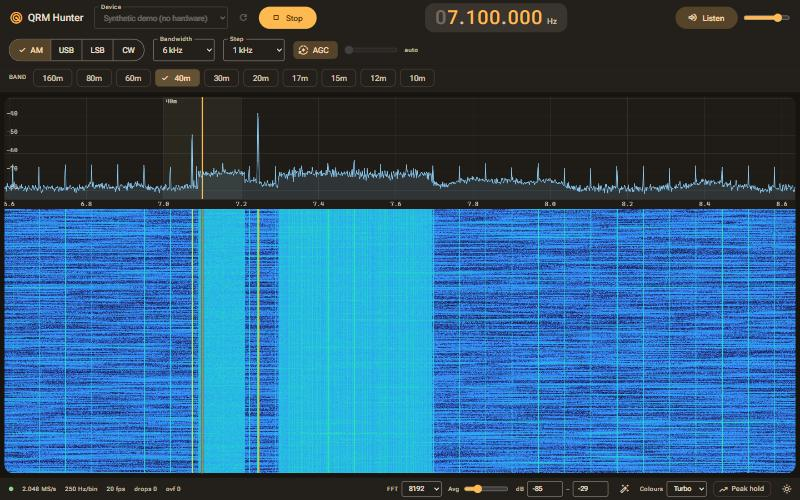

# QRM Hunter

See, record, identify and hunt down HF interference (QRM) with an RTL-SDR or any SoapySDR radio.

Built by a ham for hams who want to know whether that S7 noise floor is an inverter, a phone charger or the neighbour's VDSL. It gives you a fast live spectrum and waterfall with click-to-tune, zoom/pan, HF, VHF and UHF band presets, AM/SSB/CW/FM audio, broadcast FM with RDS, frequency memories, recording, and automatic QRM identification with the evidence behind it. It runs as a desktop window or headless on a Raspberry Pi. A 24/7 logger, step-by-step source hunting and a shared library of known QRM signatures are on the way.



## Supported hardware

| Device | How |
|---|---|
| RTL-SDR v3 / v4 / clones | Built in (pyrtlsdr). A v3 or clone switches to Direct Q below 24 MHz on its own; a v4 uses its built-in upconverter. Windows: install the WinUSB driver with [Zadig](https://zadig.akeo.ie/). |
| SDRplay, Airspy, HackRF, others | Through SoapySDR plus the device's Soapy module (see below). |
| No hardware | **Synthetic demo**, a built-in generator of typical QRM (SMPS combs, mains buzz, VDSL, impulses and more, selectable as `synthetic:<profile>` devices), plus a demo FM broadcast station with RDS. |

### Installing SoapySDR (optional)

SoapySDR is not on PyPI. Pick one:
- **Windows:** install [radioconda](https://github.com/ryanvolz/radioconda) or PothosSDR, then make sure its Python bindings are importable from the app's environment.
- **Linux (Debian/Ubuntu/Raspberry Pi OS):** `sudo apt install python3-soapysdr soapysdr-module-all`, then create the venv with `uv venv --system-site-packages` so the app can see the system bindings.
- **conda:** `conda install -c conda-forge soapysdr soapysdr-module-airspy soapysdr-module-hackrf`. SDRplay also needs the SDRplay API and the `soapysdr-module-sdrplay3` plugin.

## Run

```bash
uv sync
cd frontend && npm ci && npm run build && cd ..
uv run qrm-hunter            # desktop window
uv run qrm-hunter --serve    # headless: open http://127.0.0.1:7070
```

To reach a headless Pi from another machine, run `uv run qrm-hunter --serve --host 0.0.0.0`. It prints a URL containing an access token; keep that token private.

Other options: `--port` (default 7070), `--config` (settings file) and `--log-level`.

## Using it

- **Tune:** click the spectrum or waterfall, type a frequency, use the band chips (HF, VHF, UHF and FM BC for your IARU region), or press the left and right arrow keys to step. Scroll to zoom, drag to pan and double-click to reset the view. Panning past the edge of the received span retunes the radio.
- **Layout:** drag the divider between the spectrum and the waterfall to give either more room (the up and down arrow keys move it too when it has focus).
- **Broadcast FM:** the FM BC band selects wideband FM and decodes RDS (station name, radio text, programme type and traffic announcements) in a card under the band bar.
- **Memories:** press **M** to save the current frequency, mode and bandwidth; keys **1**-**9** recall the first nine. The Memories drawer lists, edits and deletes them.
- **Region selection:** **Shift+drag** on the spectrum or waterfall selects a frequency region; **Esc** clears it. Recording and analysis then use the region instead of the whole visible span.

## Record and analyse

- **Save last N s** (top bar) saves the last N seconds of the visible span, or of the selected region. The arrow beside it opens the record menu: choose the span and N, or **Start recording** and **Stop** a longer recording (up to 30 minutes, with a live time and size counter). Changing the frequency or sample rate ends a running recording cleanly, and a recording stops by itself if free disk space drops below 500 MB.
- Recordings are SigMF files (`iq.sigmf-meta` + `iq.sigmf-data`, ci16) with a `waterfall.png` and a `spectrum.json`, stored in `Documents/QRM Hunter/recordings` unless you choose another folder in **Settings**. The **Recordings** drawer lists them with a waterfall thumbnail, and lets you play one back through the receiver (the device becomes "Recording: ..."), analyse it, rename it, or move it to the recycle bin. The desktop window can also open the folder in your file manager.
- **Analyse** looks at the last N seconds (or a saved recording) and ranks the likely causes with a confidence bar, the evidence for each and the raw features. It needs at least 2 seconds of data and cannot run twice at once. If nothing scores high enough the answer is Unknown. An analysed clip can be saved as a recording.
- **Settings:** the pre-buffer length (0-60 s, default 10 s), the recordings folder and your callsign, which is stored in each recording's metadata. The pre-buffer holds the live data and costs about 4 bytes per sample, so 10 s at 2.048 MS/s is about 82 MB. With the pre-buffer at 0, **Save last N s** and live **Analyse** are disabled.
- The ranking combines rules (`backend/qrm_hunter/analysis/signatures.yaml`) with a small beta model trained on synthetic data. To adjust a rule, copy a signature into a `signatures.yaml` next to your `settings.toml`; entries there override the built-in ones by `id`.
- To retrain the beta model: `uv sync --group train`, then
  `uv run --group train python tools/train_ranker.py --clips-per-class 300`.

## Develop

```bash
uv run pytest                     # backend tests (add -m hardware with an SDR attached, -m "not performance" to skip the timing tests)
cd frontend
npm test && npm run check
npm run dev                       # UI on :5173, proxied to a backend on :7070 (uv run qrm-hunter --serve)
```

Settings are stored in your per-user config directory (`settings.toml`).

## Author

Shaun Scholtz, **ZS6SHZ**. Bug reports, QRM captures and pull requests are welcome.

73!
